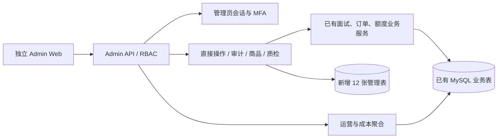

# 管理后台实现与验收

依据：运营管理后台设计方案 V1.0（2026-11-01）及项目需求说明书 V1.0。

## 差异与架构

现有 FastAPI 具备用户、授权、岗位、面试、轮次、媒体、报告、AI 调用日志、订单和额度账本。原有管理员为普通用户 ID 白名单，不能满足独立身份与最小权限要求；价格为代码常量，真实支付适配器未实现。

新增独立 React + TypeScript + Vite + Ant Design 管理入口，TanStack Query 请求缓存，Zustand 内存会话，ECharts 图表。Admin API 统一 `/api/v1/admin`，与求职端采用不同 JWT audience 和数据库会话。后台复用业务服务及业务表；采用当前服务既有 MySQL 8.4，不按旧文档改回 PostgreSQL。

## 路由与权限

| 路由        | 页面                                   | 权限                                               |
| ----------- | -------------------------------------- | -------------------------------------------------- |
| /dashboard  | 运营总览、趋势、漏斗                   | dashboard:read                                     |
| /users      | 用户检索、详情、冻结、权益申请         | user:read / user:update                            |
| /interviews | 面试检索、详情、时间轴、报告、媒体授权 | interview:read / interview:content / media:play    |
| /quality    | 抽检任务、分派、处理结论               | quality:read / quality:update                      |
| /finance    | 营收、订单、直接退款、对账导入         | finance:read / order:refund / reconciliation:write |
| /products   | 商品、版本、权益、直接发布             | product:read / product:write                       |
| /payments   | 微信/支付宝配置、密钥引用、校验        | payment:read / payment:write                       |
| /ai-ops     | 用量、成本、延迟、失败率、当前模型配置 | ai:read                                            |
| /system     | 管理员、角色、审计                     | system:read / admin:write / audit:read             |

角色：SUPER_ADMIN、OPERATIONS、SUPPORT、QUALITY、FINANCE、AUDITOR。服务端逐接口校验权限；导航隐藏仅用于交互。质检内容和媒体限定为分配给自己的任务，超级管理员可全局审阅，但仍需当前有效的用户 SUPPORT_REVIEW 授权。

## 业务选择

- CNY，金额以分存储；业务时间 UTC，统计默认 Asia/Shanghai，按自然日聚合；统计窗口不等于财务确认收入。
- 沿用面试创建时预占、业务状态机确认/返还的既有规则。
- 商品支持单次/月/季/年版本配置、直接发布；订单保存价格快照。首版会员作为固定额度套餐，不宣称已实现按月重置、自动续费和到期回收。
- 真实支付与真实退款保持关闭；配置校验及沙箱订单用于联调，生产操作明确返回未配置，不能手动标记支付成功。
- 独立审阅同意不由后台代签；媒体播放要求角色、资源范围、同意、保留期限及原因，短时 URL 仅存组件内存。
- 第一期按用户要求取消双人审批，价格发布、权益补发、退款和支付配置由有权限的管理员直接执行，保留操作原因、权限、幂等和审计。

## 数据迁移与测试

新增管理表、商品版本及订单快照使用新的独立 schema 快照和 Alembic 增量迁移。所有新表及字段提供中文 COMMENT，保留历史 schema_docs_v1.py。生成新的 MySQL 建库/增量 SQL。

测试包含：管理员与用户 token 隔离、角色越权、禁用及注销、MFA、媒体理由/同意/到期/资源范围、单人操作立即生效、写入幂等冲突、价格快照、退款账本、对账差异、分页筛选、空数据统计、迁移升级/降级、前端真实 API E2E。上线压测与真实支付渠道验收不以本地测试替代。

## 原首版验证记录（本次调整前）

- 后端全量回归：97 passed，7 skipped（环境条件测试）。
- 独立 MySQL 临时库：管理业务与迁移集成 10 passed；中文 COMMENT 与字段属性保留 5 passed。
- 最终迁移回归：2 passed，包含 Alembic upgrade、check、downgrade 与 SQL 导出核对。
- 已安装原后端代码的浏览器 E2E：4 passed，覆盖完整导航、用户/面试详情、无授权审阅拒绝、单人商品发布、财务角色隔离、390px 窄屏。
- 前端 TypeScript + Vite 构建通过；npm 依赖审计 0 vulnerabilities。页面及图表按需加载；构建仍有大于 500 KB 的共享依赖块提示。
- 原业务库增量升级至 a61d8c4e9201；原 API 进程已重启。13 个实际管台 HTTP 入口及注销撤销巡检通过。
- 初始管理员随机凭证保存在后端 `var/admin-bootstrap.json`（0600），第一期无需复核账号。

## 后续生产接入项

1. 微信/支付宝真实适配器、通知验签、渠道退款、KMS 密钥读取和自动对账拉单。
2. 会员有效期执行、按月重置、权益扣减优先级、到期回收及升级/降级规则；现有版本明确为一次性总额度包。
3. 在线模型路由版本发布、外部告警通知、访客/报告浏览埋点、异步批量导出及生产压测。

以上条目未以本地模拟功能替代，也不计为已上线能力。

## 模块关系

最终运行环境浏览器巡检通过：Vite 5174 → 原 FastAPI 8000 → 原 MySQL，可登录、加载总览及注销。

## 第一期简化：取消双人审批

- 移除审批导航、页面、API 和角色审批权限；不再创建新的审批单。
- 商品草稿直接发布，已有待审核商品也可直接发布，新版本仍保留价格快照与版本检查。
- 用户权益提交后立即到账，关联工单号选填；重复请求只记一次账。
- 支付渠道配置直接加密保存并递增版本，仍不启用尚未接入的真实支付渠道。
- 可退款的开发订单直接退款，退款失败整体回滚；原待审批退款在重新执行时保留为已拒绝历史记录，并产生直接退款记录。
- 历史审批表和审计记录保留，历史待审批单不会自动执行；如需处理，直接进入对应功能页面操作。
- 不修改历史数据库迁移或表结构。

本次简化验证：后端全量 102 passed / 7 skipped，MySQL 专项 15 passed，浏览器 E2E 7 passed，Ruff 检查通过；前端生产构建通过。
